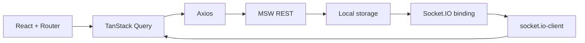

# Arquitetura, contratos e limitações

## Estado atual

Implementados: nove páginas, navegação tipada, URL de filtros, consulta REST via Axios/Query, dois usuários mock, cadastro/login/logout, favoritos otimistas, carrinho persistente e mesclado após login, cotação decimal, cupom, checkout com idempotência, recibo de pedido, atualização por Socket.IO e recuperação de pedido pendente após refresh.

**Pendências não declaradas como concluídas:** fidelidade ao Figma, upload de avatar binário, cenários determinísticos completos de timeout após pedido e latência variável entre consultas, cobertura integral dos 12 grupos de testes, snapshots de regressão visual versionados, auditorias Lighthouse com resultados reais e confirmação E2E em Chromium. O catálogo possui cenários reproduzíveis de lentidão, resultado vazio, HTTP 503 e offline por seletor no rodapé.

## Fluxo técnico

As respostas fictícias são produzidas pelos handlers MSW, não por componentes/hooks. A fixture inicial de NFTs é determinística. `localStorage` guarda o mock (`jungle-nft-mock-v1`); reset restaura tudo.

## Contratos REST

Prefixo `/api`. Rotas privadas exigem `Authorization: Bearer <token fictício>`.

| Recurso | Métodos | Erros relevantes |
|---|---|---|
| `/nfts`, `/nfts/:id` | GET | Busca/filtros/ordenação/paginação; 404 |
| `/auth/login`, `/auth/register`, `/auth/session`, `/auth/logout` | POST/GET | 401, 409, 422 |
| `/cart`, `/cart/:id` | GET/POST/PATCH/DELETE | Quantidade; 404, 409, 422 |
| `/quote` | POST | Cupom/rede/carrinho; 409 |
| `/favorites`, `/favorites/:id` | GET/POST/DELETE | 401/404 |
| `/profile`, `/profile/password` | GET/PATCH | 401/409/422 |
| `/wallets`, `/wallets/:id` | GET/POST/PATCH | 401/404/422 |
| `/orders`, `/orders/:id` | GET/POST | `Idempotency-Key`; 401/404/409/422 |
| `/scenarios/nft-update`, `/scenarios/expire`, `/scenarios/reset` | POST | Ações de demonstração |

Erros: `{ message: string, code: string }`. Quantidades são inteiras; ETH usa strings decimais calculadas por Decimal.js e apresentado com seis casas (simulação, não precisão máxima de 18 casas).

## Cache, sessão e conta

Query usa `staleTime: 30_000` e `retry: 1` para consultas gerais; a cotação desabilita retries. `queryKey` inclui identificadores e parâmetros. Login mescla carrinho guest sem ultrapassar estoque; logout/troca de usuário limpa o cache e subscriptions. Sessão mock dura uma hora e retorna 401 quando expirada. SHA-256 sem salt é apenas para credenciais fictícias; produção exige autenticação e hash robustos no servidor.

Favoritos usam `onMutate` com rollback `onError`. Ações POST/PATCH/DELETE invalidam o cache correspondente; eventos incrementais disparam reconciliação com REST.

## Compra, idempotência e recibo

Cotação é autoridade para o checkout: `quoteRevision` identifica IDs, quantidades, preços, versões, rede e cupom. Revalidação com diferença devolve 409. `Idempotency-Key` repetida com mesmo payload devolve o mesmo pedido, com payload divergente devolve conflito. Chave é persistida no navegador para reenvios após falha.

Pedido nasce `pending`, finaliza após aproximadamente 2 segundos; `GET /orders/:id` reconcilia após refresh. O recibo é snapshot imutável da cotação. Apenas após `confirmed` as quantidades compradas são removidas do carrinho. `declined` preserva itens.

## Tempo real

MSW intercepta WebSocket usando `@mswjs/socket.io-binding` e `socket.io-client` com transporte WebSocket. Eventos:

- `nft.updated`: `{ id, priceEth, available, version }`.
- `order.updated`: `{ id, userId, status, version }`.

Versões antigas/duplicadas são ignoradas. Na reconexão, queries relevantes são invalidadas. Eventos de pedido só atualizam o usuário correspondente. Binding mock suporta apenas namespace padrão e eventos texto; não simula polling, ack ou binário.

## Acessibilidade, UX e design

Há labels, foco visível, mensagens `role="alert"`/`status`, skeleton com preferência de movimento reduzido, estados vazios e ações desabilitadas conforme estoque. Ainda faltam auditorias completas de acessibilidade/zoom/teclado. O Figma original não estava acessível ao autor; as artes CSS são substituições e não reproduções dos assets. Não alegar paridade visual.

## Segurança e deployment

O mock roda inteiramente no cliente, portanto não é seguro para uso real. Sem segredos, dados pessoais nem pagamentos verdadeiros. O build público carrega MSW por padrão e precisa servir o worker. Na Vercel, `vercel.json` fornece fallback SPA. Uma aplicação real demandaria backend, autorização, prevenção a abuso, isolamento multiusuário e transações blockchain auditadas.
