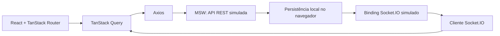

# KURIO — NFT Marketplace

Aplicação web de estudo desenvolvida com **React, TypeScript e Vite**, a partir do [desafio público de frontend da Jungle Gaming](https://github.com/junglegaming/frontend-challenge). O projeto reproduz uma experiência de marketplace de NFTs com catálogo, conta fictícia, favoritos, carrinho e checkout simulado, além de cenários de rede e atualizações em tempo real.

> **Escopo:** demonstração técnica com APIs e dados simulados no navegador. **Não há blockchain, backend de produção, carteiras com fundos ou pagamentos reais.**

**[Acessar demonstração](https://jungle-nft-marketplace-seven.vercel.app)** · **[Arquitetura](./ARCHITECTURE.md)** · **[Auditoria de performance](./PERFORMANCE_AUDIT.md)**

## Funcionalidades

- **Catálogo:** pesquisa, filtros por categoria e preço, ordenação e paginação com parâmetros preservados na URL.
- **Detalhe do NFT:** informações da obra, disponibilidade e inclusão no carrinho.
- **Conta fictícia:** cadastro, login, logout, sessão simulada e perfil; autenticação **não adequada para produção**.
- **Favoritos:** atualizações otimistas com reversão em caso de erro.
- **Carrinho:** persistência local e mesclagem do carrinho de visitante após login.
- **Checkout simulado:** cotação com valores decimais, cupom, seleção de rede/carteira fictícias, chave de idempotência, pedido e recibo.
- **Estados do pedido:** `pending`, `confirmed` e `declined`, com reconciliação após atualização da página.
- **Atualizações em tempo real simuladas:** eventos Socket.IO para preço/disponibilidade de NFTs e status de pedidos.
- **Cenários de rede no catálogo:** normal, lento, vazio, HTTP 503 e offline; restauração das fixtures de demonstração.

## Tecnologias

| Área | Ferramentas |
| --- | --- |
| Interface | React 19, TypeScript 7, Vite 8, Tailwind CSS v4, shadcn/ui |
| Navegação e dados | TanStack Router, TanStack Query, Axios |
| Simulação de serviços | MSW v2, `@mswjs/socket.io-binding`, `socket.io-client` |
| Valores monetários simulados | Decimal.js |
| Testes e auditoria | Playwright, Lighthouse |

## Arquitetura resumida



As respostas REST são produzidas pelos handlers do **MSW**. Os dados de demonstração são persistidos localmente no navegador; os eventos Socket.IO simulam atualizações e acionam reconciliação de consultas. Não existe servidor de produção por trás desses fluxos.

O checkout utiliza uma cotação identificada por `quoteRevision` e `Idempotency-Key` para simular prevenção de duplicidade de pedidos. Esses mecanismos são demonstrativos e **não constituem garantias de segurança transacional em ambiente real**.

Para contratos REST, cache, sessão, fluxo de pedidos e decisões de implementação, consulte [ARCHITECTURE.md](./ARCHITECTURE.md).

## Qualidade, testes e desempenho

A documentação do projeto registra, em **04/11/2026**, **28 testes end-to-end aprovados localmente** com Playwright em Chromium desktop e mobile. Também registra build TypeScript/Vite aprovado e lint sem erros, com avisos não bloqueantes. **Essas verificações não foram reexecutadas para esta revisão do README.**

A [auditoria Lighthouse](./PERFORMANCE_AUDIT.md), datada de **05/11/2026**, relata **12 medições laboratoriais**: três por combinação de página (Home ou detalhe NFT) e perfil (desktop ou mobile). Os valores abaixo são **medianas documentadas**, não dados de usuários reais.

| Métrica | Home desktop | Home mobile | NFT desktop | NFT mobile |
| --- | ---: | ---: | ---: | ---: |
| Performance | 99 | 87 | 99 | 86 |
| Acessibilidade automatizada | 97 | 97 | 93 | 96 |
| Boas práticas | 100 | 100 | 100 | 100 |
| SEO | 92 | 92 | 92 | 92 |
| LCP (aprox.) | 0,87 s | 3,73 s | 0,86 s | 3,65 s |
| CLS (aprox.) | 0,001 | 0,005 | 0,003 | 0,079 |
| TBT | 0 ms | 175 ms | 0 ms | 184 ms |

**Oportunidades identificadas:** reduzir o LCP em dispositivos móveis e ampliar a auditoria manual de acessibilidade. Pontuações do Lighthouse não comprovam conformidade integral de acessibilidade nem Core Web Vitals em campo.

### Comandos de validação

```bash
npm run typecheck
npm run lint
npm run build
npm run test:e2e
```

O Playwright está configurado para Chromium em perfis desktop (1440 px) e mobile (390 px), com relatório HTML e traces de falhas. Há quatro baselines visuais versionadas (Home e detalhe NFT em desktop/mobile). Para consultar o relatório local:

```bash
npm run test:e2e:report
```

Para atualizar as referências visuais, após revisar as diferenças:

```bash
npm run test:e2e:update
```

## Executar localmente

**Pré-requisitos:** Node.js 24+ e npm. As instruções foram documentadas para WSL/Linux.

```bash
npm ci
npm run dev
```

Abra `http://localhost:5173/`.

Se necessário, instale o Chromium utilizado nos testes:

```bash
npx playwright install chromium
```

Para gerar e pré-visualizar a versão de produção:

```bash
npm run build
npm run preview
```

O build produz a pasta `dist/`. Para hospedar uma SPA, configure fallback de rotas para `index.html`; o repositório inclui `vercel.json`. O arquivo `public/mockServiceWorker.js` deve ser servido na raiz.

### Ambiente de demonstração

`VITE_ENABLE_MOCKS` é `true` por padrão, inclusive no build demonstrativo. Desative apenas ao integrar serviços REST e Socket.IO próprios. **Não armazene segredos reais em variáveis `VITE_*`.**

**Credenciais exclusivamente fictícias:**

| E-mail | Senha |
| --- | --- |
| `demo@jungle.test` | `Demo1234!` |
| `test@jungle.test` | `Teste1234!` |

O mock compara hashes SHA-256 de senhas fictícias. Isso **não representa autenticação segura de produção**.

## Roteiro de demonstração

1. **Catálogo:** selecione a categoria **Jogos**, pesquise `Vessel`, altere a ordenação e recarregue para observar os filtros na URL.
2. **Carrinho:** abra um NFT, selecione quantidade e adicione ao carrinho ou use **Comprar NFT** para iniciar o checkout.
3. **Cupom:** aplique `JUNGLE10`; experimente `EXPIRED` ou um código desconhecido para observar erros simulados.
4. **Login:** entre com uma conta fictícia e observe a mesclagem do carrinho de visitante.
5. **Checkout:** selecione rede/carteira fictícias, revise a cotação e confirme. Observe os estados do pedido.
6. **Atualização simulada:** use **Simulate live price update** para alterar o preço e emitir `nft.updated`.
7. **Falha simulada:** ative **Simulate payment refusal** para verificar a preservação do carrinho.
8. **Conta:** explore perfil, alteração fictícia de senha, carteiras e favoritos.
9. **Rede:** no seletor **Simular condição de rede**, teste `Slow`, `Empty`, `HTTP 503` e `Offline` no catálogo; depois volte a `Normal`.
10. **Reiniciar:** use **Restaurar demonstração** no rodapé para repor fixtures, sessões, carrinhos e pedidos.

## Organização do código

```text
src/components/   Interface, cartões NFT, artwork e componentes UI
src/lib/          Tipos, cliente Axios e sessão
src/mocks/        Fixtures e handlers REST/Socket.IO
src/routes/       Páginas e navegação com TanStack Router
tests/            Testes Playwright
public/           Service Worker do MSW
```

## Escopo e limitações

- **Não há blockchain, transações reais, backend de produção nem autenticação segura para uso real.** Os dados são simulados e persistidos por navegador/dispositivo.
- As artes dos primeiros NFTs reutilizam imagens da referência; outras obras usam ilustrações CSS. A fidelidade pixel a pixel ao Figma **não foi validada**.
- Os cenários de rede configuráveis cobrem o catálogo; timeout após pedido, variações de latência entre consultas e regressões visuais ainda não têm cobertura integral.
- A acessibilidade foi parcialmente avaliada por ferramentas automatizadas; faltam verificações manuais completas de teclado, zoom e outros cenários.
- Não utilize dados pessoais reais, credenciais de produção ou carteiras com fundos nesta demonstração.

## Referências

- [Desafio original — Jungle Gaming](https://github.com/junglegaming/frontend-challenge)
- [Documentação de arquitetura e contratos](./ARCHITECTURE.md)
- [Auditoria de performance e metodologia](./PERFORMANCE_AUDIT.md)

---

*Projeto de estudo e portfólio, com funcionalidades e limites descritos de forma verificável.*
